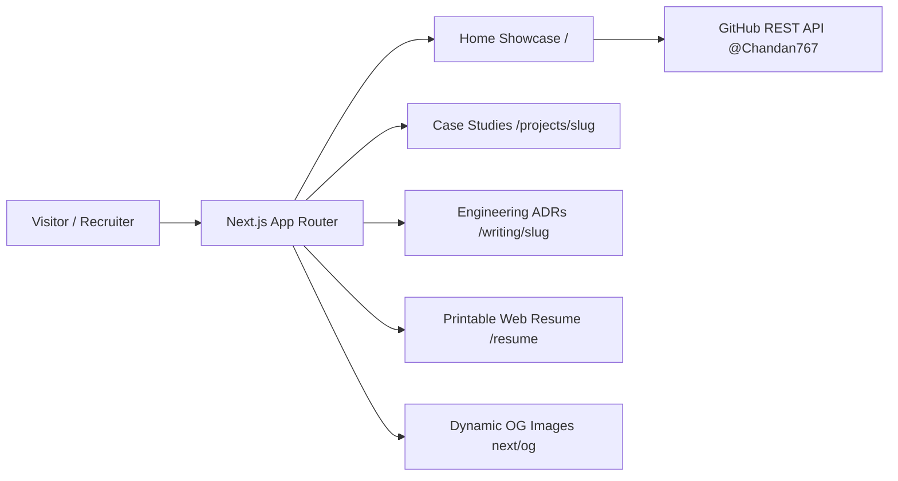

# Chandan V N (@Chandan767) — Engineering Portfolio

A recruiter-ready, NDA-safe full-stack & systems engineering portfolio built with **Next.js (App Router)**, **TypeScript**, **Tailwind CSS v4**, and **Framer Motion**.

- **Live Portfolio:** https://chandan767.vercel.app *(also available at https://chandan-portfolio-rose.vercel.app)*
- **Interactive Web Resume:** `/resume`
- **Engineering Notes & ADRs:** `/writing`

---

## Highlights & Interactive Features

- **Executive Monochrome + Editorial Teal Theme:** Obsidian Zinc (`#09090B`) dark-first design with persistent Dark/Light toggle (`useSyncExternalStore`) and global `prefers-reduced-motion` support.
- **3-Second Hero + Production Snapshot Terminal:** Immediate first-paint headline, availability context strip, and verified ownership snapshot (`967+` commits, `161` PostgreSQL models, `88` API route modules, `15+` campuses).
- **Flagship Enterprise EdTech Platform (4 Interactive Tabs):**
  - Explicit **"I vs. We" Ownership Strips** on every module.
  - **Production Reliability & Scale Highlights:** PM2 Cluster Mode (`800MB` rolling memory restarts / `1GB` heap cap), composite PostgreSQL indexes, ICSE/CBSE campus isolation, 12-month compliance audit logging, and Capacitor iOS/Android CI/CD.
  - **Interactive Teardowns:** *Uncached Direct RDS vs. L1/L2 Redis + PM2 Cluster* toggle and an *OWASP Security Hardening* accordion on `/projects/enterprise-edtech-platform`.
- **Featured Systems & Interactive Micro-Demos:**
  - **AI Stock Research & Prediction Agent (NSE/BSE):** Quantitative-first LangGraph agent + interactive NSE dual-score simulator (`TCS`, `RELIANCE`, `HDFCBANK`, `INFY`).
  - **Zoho → NeverSkip Enterprise API Integration:** OAuth 2.0 middleware with schema normalization and 0% duplicate idempotent upserts (`Private Production (NDA)`).
  - **n8n Slack → Google Drive Automation Pipeline:** Event-driven archival with duplicate detection and instant Slack thread replies.
  - **Diabetes Prediction System:** Balanced Random Forest ML classifier (`76.6%` accuracy, `74.5%` precision, `76.7%` recall) + interactive clinical risk screening sandbox.
- **Interactive 8-Layer Production Architecture Explorer** + **Live GitHub Activity Card** + **`Ctrl+K` Command Palette** + **4 Engineering Notes / ADRs (`/writing`)** + **Dynamic Per-Project OpenGraph Cards**, `sitemap.xml`, `robots.txt`, and JSON-LD `Person` schema.

---

## Architecture Overview



---

## Tech Stack

| Layer | Stack |
| --- | --- |
| Framework | Next.js 16 (App Router) · React 19 · TypeScript |
| Styling | Tailwind CSS v4 · CSS Variables (Dark/Light) |
| Motion & UI | Framer Motion · Lucide React · Custom SVG Icons |
| Fonts | Plus Jakarta Sans · Inter · JetBrains Mono (`next/font`) |
| SEO & OG | Dynamic `next/og` (`ImageResponse`) · `sitemap.ts` · `robots.ts` · JSON-LD |
| Deployment | Vercel (auto-deployed from `main`) |

---

## Run Locally

```bash
git clone https://github.com/Chandan767/chandan-portfolio.git
cd chandan-portfolio
npm install
npm run dev
```

Open [http://localhost:3000](http://localhost:3000).

### Production Verification

```bash
npm run lint
npm run build
```

---

## Contact

- **Email:** chandan.76762@gmail.com
- **GitHub:** [@Chandan767](https://github.com/Chandan767)
- **LinkedIn:** [linkedin.com/in/chandan767](https://linkedin.com/in/chandan767)
